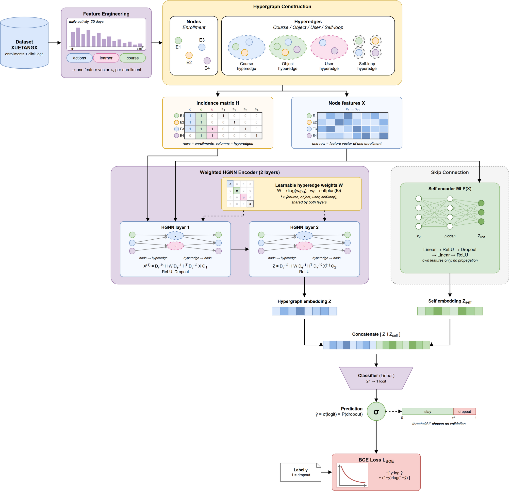
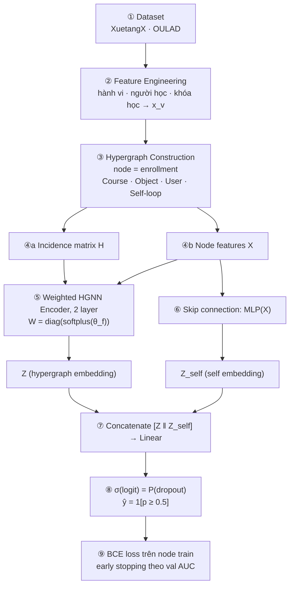

# Tổng quan project: dự đoán dropout bằng Hypergraph Neural Network

Cập nhật: 2026-10-08 (commit 601b5df + code OULAD chưa đưa vào git).
Sơ đồ gốc: [hypergraph-neural-network-v5.png](assets/hypergraph-neural-network-v5.png). Ghi chú này đi lần lượt
theo các khối trong sơ đồ (① → ⑨). Mỗi khối ghi: khối làm gì, số liệu của hai dataset, và file code tương ứng.





## Bảng nhanh: khối → file code

| Khối trong sơ đồ | XuetangX (`src/`) | OULAD (`baseline/new_dataset/OULAD/`) |
|---|---|---|
| Cấu hình chung | `0_config.py` | `0_config.py` |
| ① Dataset | `1_download.py`, `2_preprocess.py` | `1_download.py`, `2_preprocess.py` |
| ② Feature Engineering | `3_features.py` | `3_features.py` |
| ③ Hypergraph Construction | `4_hypergraph.py` | `4_hypergraph.py` |
| ④ H và X | `5_graph_data.py` | `5_graph_data.py` (copy nguyên) |
| ⑤ Weighted HGNN Encoder | `6_hgnn.py` | `6_hgnn.py` (copy nguyên) |
| ⑥ Skip connection MLP | `7_mlp.py` | `7_mlp.py` (copy nguyên) |
| ⑦ Concatenate + Classifier | `8_model.py` | `8_model.py` (copy nguyên) |
| ⑧ Prediction + ⑨ BCE loss, train | `9_train.py` | `9_train.py` |
| Bảng kết quả | `10_summary.py` | `10_summary.py` (copy nguyên) |

Khối ⑤–⑨ dùng **cùng một code** cho cả hai dataset. Hai dataset chỉ khác nhau ở khối ①–③.

---

## ① Dataset

| | XuetangX | OULAD |
|---|---|---|
| Nguồn | moocdata.cn (Feng et al., AAAI 2019, CFIN) | Kuzilek et al., Scientific Data 2017; tải từ UCI |
| Loại khóa học | MOOC mở | Module đại học từ xa (Open University, UK) |
| Node = enrollment | (user, course) | (id_student, code_module, code_presentation) |
| Số node | 225.642 | 32.593 (giữ tất cả, như Wu et al. 2026) |
| Train / val / test | 126.354 / 31.589 / 67.699 | 20.859 / 5.215 / 6.519 |
| Cách chia | Train chính thức → 80/20 (seed 1); test chính thức | Xáo seed 1: 80% → train/val 80/20; 20% → test |
| Nhãn dropout = 1 | Có sẵn trong file truth | `final_result = Withdrawn` (như Wu et al. 2026) |
| Tỉ lệ dropout train / val / test | 0,758 / 0,760 / 0,758 | 0,310 / 0,312 / 0,316 |
| Cửa sổ quan sát | Ngày 0–34 của khóa | Ngày 0–34 của module |
| Đơn vị log | 1 dòng = 1 sự kiện | 1 dòng = tổng click của 1 tài liệu trong 1 ngày |

## ② Feature Engineering → một vector x_v cho mỗi enrollment

Ba nhóm trong sơ đồ (actions · learner · course) ứng với ba khối cột của X.

| Khối | XuetangX (89 cột) | OULAD (103 cột) |
|---|---|---|
| Hành vi (actions) | **59**: 35 số sự kiện theo ngày · tổng sự kiện · số object khác nhau · 22 action (MST-GCN) | **60**: 35 tổng click theo ngày · tổng click · 18 activity_type · 6 cột assessment (Wu et al.) |
| Người học (learner) | **12**: gender, education one-hot (+ missing) · age (CFIN) | **32**: region, highest_education, imd_band (+ missing) one-hot · studied_credits, num_of_prev_attempts, date_registration |
| Khóa học (course) | **18**: category one-hot (+ missing) | **11**: code_module, code_presentation one-hot |
| Chuẩn hóa | Cột đếm: `(log(1+c) − μ_train)/σ_train`; age: z-score | Cột đếm: log1p + z; các số khác: z; submitted_any và one-hot giữ 0/1 |
| Giá trị thiếu | One-hot có cột missing | One-hot: cột missing chỉ cho imd_band; trường số: 0 |
| Không đưa vào X | — | gender, age_band, disability (thuộc tính được bảo vệ, theo Wu); final_result, date_unregistration (lộ nhãn) |

6 cột assessment của OULAD (theo code của Wu, đã sửa để không dùng dữ liệu sau ngày 35): n_assess, submitted_any,
avg_score, weighted_score, mean_lateness, max_lateness. Chỉ tính bài có hạn nộp trong ngày 0–34 **và** được nộp trước ngày 35.

Mọi μ, σ chỉ tính trên train. Chi tiết: [FEATURE_ENGINEERING.md](FEATURE_ENGINEERING.md) (XuetangX), [PLAN_OULAD_v5.md](PLAN_OULAD_v5.md) (OULAD).

## ③ Hypergraph Construction

Một hypergraph H dựng trên **mọi** node train + val + test (transductive, như HGNN+/DHG). Nhãn của val/test
không bao giờ được dùng khi train.

| Hyperedge | Luật | XuetangX | OULAD |
|---|---|---|---|
| Course | cùng course / module-presentation | 247, phủ 100% node | 22, phủ 100% |
| Object | cùng dùng 1 object trong ngày 0–34 | 22.421, phủ 88,4% | 3.465 (`id_site`), phủ 86,1% |
| User | mọi enrollment của cùng 1 người ("any") | 64.672, phủ 94,5% | 3.538, phủ 22,5% |
| Self-loop | mỗi node 1 cái (thêm khi load) | 225.642 | 32.593 |
| Tổng số lần tham gia (không tính self-loop) | | 3.222.033 | 774.653 |

Chỉ giữ hyperedge có từ 2 thành viên trở lên. Object luôn nằm gọn trong 1 Course (đã kiểm tra trên cả hai dataset).

## ④ Incidence matrix H và Node features X

- **H** (N × E): `h(v, e) = 1` nếu node v thuộc hyperedge e. File lưu dạng danh sách thành viên trong `hypergraph.npz`
  (`node_ids`, `edge_ids`, `edge_family`, `labels`, `split`).
- **X** (N × D): ghép `X_train; X_val; X_test` theo thứ tự node của H.
- `apply_scenario` (trong `5_graph_data.py`) bỏ các nhóm hyperedge và cột X theo từng kịch bản, rồi trả về chỉ số
  train / val / test.

## ⑤ Weighted HGNN Encoder (2 layer)

Mỗi nhóm hyperedge f ∈ {course, object, user, self-loop} có một trọng số học được, dùng chung cho cả 2 layer:

```
w_f = softplus(θ_f)            (khởi tạo θ_f = log(e − 1), nên w_f = 1 lúc đầu)
W   = diag(w_f(e))
d(v) = Σ_e h(v,e)·w_e          δ(e) = |e|
G   = Dv^-1/2 · H · W · De^-1 · Hᵀ · Dv^-1/2

Layer 1: X⁽¹⁾ = ReLU(G · (X·Θ1 + b1)), sau đó Dropout 0,5
Layer 2: Z    = ReLU(G · (X⁽¹⁾·Θ2 + b2))
```

Ý tưởng HGNN của Feng et al. (2019); trọng số theo nhóm hyperedge lấy ý từ HGNN+. Kích thước ẩn h = 128.

## ⑥ Skip connection: MLP(X)

Chỉ dùng feature của chính node, không lan truyền qua graph:

```
Z_self = ReLU( Dropout(ReLU(x·A1 + c1)) · A2 + c2 )
```

## ⑦ Concatenate + Classifier

```
logit = [Z ‖ Z_self] · u + b          (2h → 1)
```

Kịch bản H bỏ nhánh MLP, khi đó `logit = Z · u + b`.

## ⑧ Prediction

```
p = σ(logit) = P(dropout)
ŷ = 1[p ≥ 0,5]
```

Lưu ý: sơ đồ ghi "threshold t* chosen on validation", nhưng code đang dùng **ngưỡng cố định 0,5**
(`THRESHOLD` trong `0_config.py`). Cần sửa sơ đồ hoặc code cho khớp nhau.

## ⑨ BCE loss và cách train

| Mục | Giá trị |
|---|---|
| Loss | `L = −(1/|V_train|)·Σ [y·log p + (1−y)·log(1−p)]`, chỉ trên node train |
| Cách train | Full batch: mỗi epoch chạy forward 1 lần trên toàn bộ H |
| Optimizer | Adam: lr 1e-3, weight decay 5e-4; riêng θ_f: lr 0,05, không weight decay; clip gradient ‖g‖ ≤ 5 |
| Dropout, h | 0,5 · 128 |
| Early stopping | Tính val AUC mỗi 5 epoch, patience 40, tối đa 1000 epoch; giữ trọng số tốt nhất trong RAM |
| Đánh giá | Chấm val và test **một lần** bằng trọng số tốt nhất: AUC, AUPRC, accuracy, precision, recall, F1 |
| Seed | 1, 11, 111, 1111, 11111 |
| Kiểm tra rò nhãn | Đảo toàn bộ nhãn val/test thì loss và trọng số khi train vẫn giống hệt (đạt trên cả hai dataset) |

## Kịch bản thực nghiệm (giống nhau cho hai dataset)

Mỗi kịch bản đổi đúng **một** khối so với M. Chi tiết: [KICH_BAN_THUC_NGHIEM.md](KICH_BAN_THUC_NGHIEM.md).

| Mã | Khối bị đổi | Thay đổi |
|---|---|---|
| **M** | — | Mô hình đầy đủ như sơ đồ |
| A1 / A2 / A3 / A4 | ③ | Bỏ Course / Object / User / Self-loop |
| W1 | ⑤ | W = I cố định (không học W) |
| F1 / F2 / F3 | ② | Chỉ hành vi / hành vi + người học / hành vi + khóa học |
| L1 | ⑤ | HGNN 1 layer |
| H | ⑥ | Bỏ nhánh MLP |
| X1 (tùy chọn) | ③ | Chỉ self-loop (nhánh HGNN thành MLP) |

`--scenario all` = 11 kịch bản × 5 seed = 55 lần chạy cho mỗi dataset.

## Lệnh chạy

```
# XuetangX (đứng ở thư mục gốc project)
python src/1_download.py && python src/2_preprocess.py && python src/3_features.py && python src/4_hypergraph.py
python src/9_train.py --scenario all --seeds 1 11 111 1111 11111
python src/10_summary.py                      # outputs/summary.csv, outputs/ket_qua.xlsx

# OULAD (đứng trong baseline/new_dataset/OULAD)
python 1_download.py && python 2_preprocess.py && python 3_features.py && python 4_hypergraph.py
python 9_train.py --scenario all --seeds 1 11 111 1111 11111
python 10_summary.py                          # outputs/oulad/summary.csv, outputs/oulad/ket_qua.xlsx
```

## Trạng thái hiện tại

| Mục | Trạng thái |
|---|---|
| XuetangX, transductive (d5c7771) | Code xong, đã kiểm tra; **chưa có kết quả**. Các số cũ (M = 0,8759) là của cách đánh giá inductive, không so được |
| OULAD | Code xong trong `baseline/new_dataset/OULAD` (ngoài git); bước 1–4 và các kiểm tra đã chạy; **chưa train thật** |
| Baseline đã công bố | CFIN có trong `baseline/CFIN`; các baseline khác nằm ở git tag `full-hsl` |
| **Lỗi cần sửa trước khi chạy XuetangX** | `src/9_train.py`: `RESULT_COLUMNS` ghi `auc, auprc, …` nhưng code ghi `test_auc, …`, nên lúc ghi `results.csv` sẽ lỗi ngay seed đầu tiên. Bản OULAD đã dùng `test_*` |
| Tài liệu cần cập nhật | Sơ đồ (ngưỡng t*, khối Dataset mới ghi XuetangX); `PLAN_OULAD_v5.md` (nhãn giờ là Withdrawn); README (vẫn dẫn tới sơ đồ v4) |

## Rủi ro cần báo thầy hướng dẫn

- **User "any" có thể lộ tương lai.**
  - Trên OULAD: sinh viên chỉ học lại module khi lần trước không qua. Có 1.309 node có lần học lại ở kỳ sau; 99,6% trong số đó là Withdrawn hoặc Fail.
  - Trên XuetangX: cũng nối các khóa bắt đầu sau.
- **OULAD giữ cả những bạn đã rút trước ngày 35** (5.335 bạn), giống Wu et al. 2026. AUC vì vậy dễ đẹp hơn so với các bài đã bỏ nhóm này.
